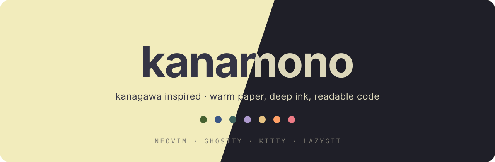
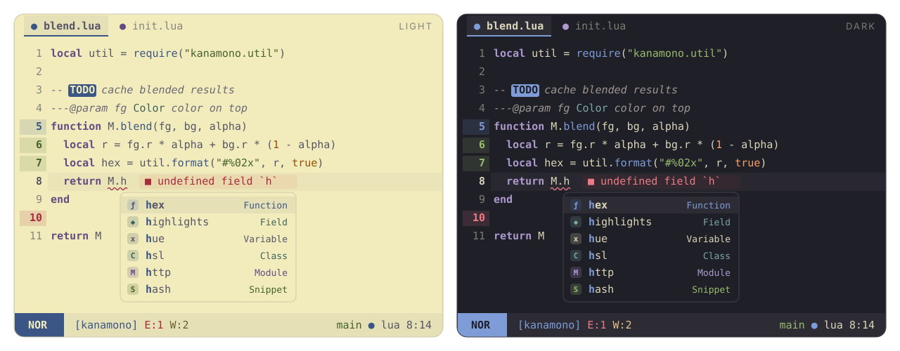

<p align="center"></p>

Kanagawa com vermelho reservado para erros e remoções, coluna de números com o mesmo fundo do editor e modo claro com mais contraste. Baseado na estrutura e nas integrações do [onemono.nvim](https://github.com/amonteirom96/onemono.nvim), com cores adaptadas do [kanagawa.nvim](https://github.com/rebelot/kanagawa.nvim).

<p align="center"></p>

## Aparência

- **Dark:** fundo Wave (`#1f1f28`) e texto Fuji White (`#dcd7ba`).
- **Light:** papel Lotus (`#f2ecbc`) com texto cinza Lotus (`#545464`).
- Strings verdes, funções azuis, tipos aqua, constantes e números laranja, palavras-chave violetas e operadores dourados. `mono = true` deixa o código monocromático.
- Vermelho nos erros, diagnósticos de erro, marcadores de erro e remoções do Git. O modo Visual da statusline usa violeta.
- Mesmo fundo do editor em números, sinais e dobras, inclusive na linha atual. A opção de transparência remove esses fundos.
- No mini.pick (`<leader>ff`), os trechos encontrados têm fundo dourado e a linha selecionada tem destaque azul.
- Texto principal com contraste de **6,19:1 no light** e **11,26:1 no dark**. Todos os acentos passam de **4,5:1** no fundo normal e em `surface2`; comentários passam de 4,5:1 no fundo normal. Cores decorativas e texto atenuado da interface usam outro nível de contraste. Personalizações e transparência podem alterar esses resultados.

## Instalação

Neovim 0.10+ e terminal com truecolor. Com lazy.nvim:

```lua
{
  "amonteirom96/kanamono.nvim",
  lazy = false,
  priority = 1000,
  config = function()
    require("kanamono").setup({})
    vim.cmd.colorscheme("kanamono")
  end,
}
```

Para experimentar este checkout local, use `dir = "/Users/arthurmonteiro/Sites/themes/kanamono.nvim"` no lugar do nome do repositório.

```vim
colorscheme kanamono       " segue background
colorscheme kanamono-dark  " força dark
colorscheme kanamono-light " força light
```

O tema é independente: não é necessário instalar Kanagawa ou onemono.

## Configuração

`setup()` é opcional. Opções padrão:

```lua
require("kanamono").setup({
  variant = "auto", -- auto | light | dark
  transparent = false,
  terminal_colors = true,
  dim_inactive = false,
  muted_comments = false, -- true reduz o contraste dos comentários
  mono = false,
  float = { solid = false },
  styles = {
    comments = { italic = true },
    keywords = { bold = true },
    functions = {}, variables = {}, strings = {},
    types = {}, constants = {}, operators = {},
  },
  integrations = {
    blink = true, dropbar = true, gitsigns = true,
    grug_far = true, lazy = true, mason = true, mini = true,
    semantic_tokens = true, statusline = true, treesitter = true,
  },
  cache = true,
  -- on_colors = function(c, variant) end,
  -- on_highlights = function(hl, c, variant) end,
})
```

Exemplo de personalização:

```lua
require("kanamono").setup({
  on_colors = function(c, variant)
    if variant == "dark" then
      c.gutter = "#16161d"
    end
    c.code.keyword = c.fg -- palavras-chave sem cor
  end,
  on_highlights = function(hl, c)
    hl.CursorLineNr = { fg = c.yellow, bg = c.gutter, bold = true }
  end,
})
```

## Integrações

Mantém os grupos do onemono para blink.cmp (e `CmpItemKind*`), dropbar, gitsigns, grug-far, lazy.nvim, mason.nvim, mini.icons, mini.pick/extra, mini.files e mini.tabline. Inclui Tree-sitter, tokens semânticos LSP e grupos `St*` para a sua statusline (`StModeNormal`, `StGit`, `StError`, etc.).

Os highlights são compilados em cache separado do onemono. Comandos:

- `:KanamonoCompile`: limpa o cache e recarrega o tema ativo.
- `:KanamonoClearCache`: remove o cache.
- `:KanamonoExtras [diretório]`: gera temas para Ghostty, Kitty e Lazygit.

Os arquivos prontos ficam em [extras](extras). Configure Ghostty com `theme = kanamono-dark` ou `theme = kanamono-light` após copiar o arquivo para o diretório de temas; para Kitty, inclua o `.conf` correspondente; para Lazygit, use a seção `gui` do YAML.

## Validação

```sh
nvim --headless -u NONE --cmd 'set rtp^=.' -l tests/smoke.lua
nvim --headless -u NONE --cmd 'set rtp^=.' -l scripts/contrast.lua
nvim --headless -u NONE --cmd 'set rtp^=.' -l scripts/assets.lua
```

A prévia é uma ilustração SVG gerada da paleta, não uma captura de tela. Licença MIT; atribuições do onemono e Kanagawa preservadas em [LICENSE](LICENSE).
